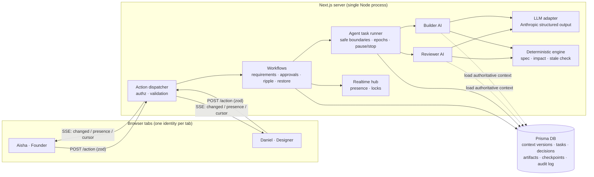

# Buildify CoLab

**Two humans. Two AI agents. One shared product. Every decision understood.**

A preview-first, context-aware multiplayer AI workspace for the TechnoTribes / Buildify hackathon ("From Multi-Agent to Multiplayer AI"). A founder and a designer collaborate in real time with a **Reviewer AI** (coordinator) and a **Builder AI** (developer) on one visible product artifact. Requirement changes ripple through a dependency graph, outdated agent work is quarantined, agents recover context after a restart, and every decision is recorded in a navigable time machine.

The flagship demo project is **CareConnect — accessible healthcare appointment booking**; the platform itself is domain-independent (create any project from the dashboard).

> Not affiliated with or integrated into Buildify. The artifact layer is a structured AppSpec, so a Buildify-like generation service could be plugged in behind the Builder later.

## Quick start

Requirements: Node.js 20+ (tested on 26), npm. No Docker or Postgres needed locally.

```bash
cp .env.example .env
```

```bash
npm install
```

```bash
npm run setup
```

```bash
npm run dev
```

Open http://localhost:3000, pick **Aisha (Founder)**. Open a second tab or browser, pick **Daniel (Designer)**. Open **CareConnect** in both — the demo guide in the corner walks through all 17 steps and ticks them off from live state.

- No `ANTHROPIC_API_KEY`? Everything still works: agents use a deterministic rules engine and every output is labelled **Rules engine**. Set the key to switch to the LLM (labelled **LLM**).
- Reset the demo at any time from the demo guide (or `npm run db:seed`).

## Tests

```bash
npm test
```

20 tests: engine unit tests (simplification, fingerprints, stale detection, ripple traversal, impact-aware rebuild) and a full demo scenario against a real SQLite DB using the real task runner (two-human approval gate, observer permissions, parallel agents, mid-flight change, quarantine, conflict detection, restart/recovery, rebuild/validation/approval, compare, safe restore, pause/resume/stop).

## Architecture



Key ideas:
- **Shared context service, not the Reviewer**, is the source of truth. Agents load an immutable `ContextVersion`; each task stores a fingerprint of the requirement versions it depends on.
- **Stale check before commit.** When an agent finishes, its fingerprint is compared with the live requirements; mismatches are quarantined, explained, and the Reviewer prepares an updated task for human approval.
- **Epochs.** Restarting an agent bumps its epoch; every runner write is guarded by epoch, so pre-restart work can never commit.
- **Deterministic first, AI second.** Ripple Effect uses requirement and component graphs plus a simulated rebuild diff; AI additions are labelled *inferred*.
- **Safe artifact.** Previews and builds are JSON AppSpecs rendered by a whitelist renderer — no generated code is executed.

More: [docs/FEATURE_STATUS.md](docs/FEATURE_STATUS.md), [docs/DEMO_SCRIPT.md](docs/DEMO_SCRIPT.md), [docs/SOLUTION.md](docs/SOLUTION.md), [docs/PROGRESS.md](docs/PROGRESS.md).

## Configuration (`.env`)

| Variable | Default | Purpose |
|---|---|---|
| `DATABASE_URL` | `file:./dev.db` | SQLite path (relative to `prisma/`) or a Postgres URL |
| `AUTH_SECRET` | — | HMAC secret for demo session tokens |
| `ANTHROPIC_API_KEY` | empty | Enables the LLM path |
| `ANTHROPIC_MODEL` | `claude-opus-5-5` if unset | Model id |
| `BC_LLM_EFFORT` | `medium` | Effort level for LLM calls |
| `BC_PRICE_IN_PER_MTOK` / `BC_PRICE_OUT_PER_MTOK` | 2 / 10 | Cost estimate pricing |
| `BC_AGENT_STEP_MS` | 2500 | Pacing per agent phase (demo visibility) |
| `BC_BUILD_PACING` | 5 | Multiplier for full builds, so humans can change requirements mid-flight |
| `BC_TASK_TIMEOUT_MS` / `BC_LLM_TIMEOUT_MS` | 120000 / 60000 | Timeouts |

LLM calls use `client.beta.messages.parse` with a Zod schema, bounded retries, a timeout, refusal handling and the server-side `fallbacks: "default"` option.

## Using PostgreSQL / Supabase

Change `provider = "sqlite"` to `"postgresql"` in `prisma/schema.prisma`, set `DATABASE_URL`, then `npm run setup`. JSON is stored as text and statuses as strings, so no model changes are needed.

## Deployment

The app needs a **long-running Node process** (SSE connections and in-process agent jobs), so serverless platforms are not a fit. Suggested: Render, Railway or Fly.io.

1. Use Postgres (above) or a persistent volume for SQLite.
2. Build command: `npm ci && npx prisma db push && npm run build`
3. Start command: `npm start`; set `AUTH_SECRET` (and optionally `ANTHROPIC_API_KEY`).
4. Run `npm run db:seed` once for the demo project.

Run a single instance — the realtime hub is in-memory. No public deployment has been made from this repository yet.

## Security notes

Project membership is checked on every API route; inputs are validated with Zod; observers are read/comment-only; AI agents cannot vote; retries and timeouts are bounded; cancellation is cooperative and late outputs are rejected; all state changes run in transactions and are written to an audit log. Demo identities are not real authentication.

## Developer tooling

[Graphify](https://github.com/Graphify-Labs/graphify) builds a code graph for navigating this repository (`graphify update src`, then `graphify explain "<symbol>" --graph src/graphify-out/graph.json`). This is separate from the product's own project-context graph.
